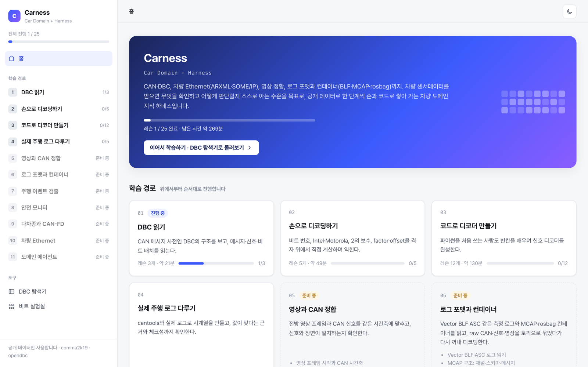
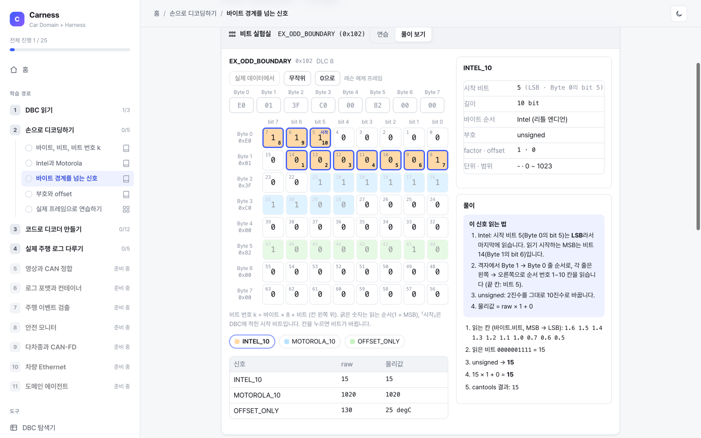

<div align="center">

# Carness

**Car Domain + Harness**

공개 차량 데이터로 쌓는 차량 도메인 지식 하네스

[](https://github.com/IJLee0812/Carness/actions/workflows/ci.yml)
[](https://www.python.org/)
[](https://github.com/astral-sh/uv)
[](https://github.com/astral-sh/ruff)
[](LICENSE)

</div>

<p align="center"></p>

## 목표

차량 센서데이터를 받았을 때 **무엇을 확인하고 어떻게 판단할지 스스로 아는 수준**, 즉 차량 도메인 에이전트에 다다르는 것이 목표입니다.

그래서 Carness는 두 가지를 함께 쌓습니다.

- **Car Domain**: CAN·DBC, 차량 Ethernet, 영상 정합, 측정 로그와 컨테이너 포맷까지 차량 데이터를 다루는 지식
- **Harness**: 그 지식을 「값이 나왔다」가 아니라 「값이 맞다는 근거」로 확인하는 점검 순서, 테스트, 실습 도구

모든 내용은 공개 데이터셋과 오픈소스에서 출발하고, 한 단계씩 손과 코드로 확인한 것만 남깁니다.

## 다루는 영역

| 영역 | 내용 | 상태 |
|---|---|---|
| **CAN · DBC** | DBC 구조, 비트 번호, Intel·Motorola, 2의 보수, factor·offset, 디코더 구현 | ✅ 학습 가능 |
| **디코딩 검증** | cantools 대조, 실제 로그 시계열·주기, 차속 교차 검증, 체크섬 | ✅ 학습 가능 |
| **영상 정합** | 전방 영상 프레임과 CAN 시간축 맞추기, 신호와 장면 비교 | 🧭 준비 중 |
| **로그 포맷 · 컨테이너** | Vector BLF·ASC, MCAP, rosbag. 토픽으로 묶고 다시 꺼내 디코딩 | 🧭 준비 중 |
| **주행 이벤트 검출** | 급제동·차로 변경 같은 구간을 신호로 찾고 영상으로 확인 | 🧭 준비 중 |
| **안전 모니터** | 수신 주기·카운터·체크섬 감시, 결함 주입과 검출 지연 | 🧭 준비 중 |
| **다차종 · CAN-FD** | 차종별 DBC 비교, CAN-FD 프레임과 DBC | 🧭 준비 중 |
| **차량 Ethernet** | ARXML의 PDU·신호 정의, SOME/IP 메시지 | 🧭 준비 중 |
| **도메인 에이전트** | 로그를 받으면 확인하는 순서와 판단 근거를 하나의 하네스로 | 🧭 준비 중 |

## 빠른 시작

```sh
uv sync                                    # Python 3.12 가상환경 + 의존성 (uv.lock 기준)
uv run python scripts/download_example.py  # comma2k19 예제 세그먼트 (RAV4, 약 50MB)
uv run carness-lab                         # 학습 화면 → http://127.0.0.1:8780
```

더 많은 실제 데이터가 필요하면 `scripts/download_comma2k19.sh 3 --unzip` 으로 Civic 청크(약 9.4GB, 끊기면 같은 명령으로 이어받기)를 받습니다.

## 학습 화면

왼쪽에 학습 경로(모듈 → 레슨)가, 오른쪽에 레슨이 나옵니다. 레슨은 세 가지입니다.

- **읽기**: 설명 사이에 직접 만져 보는 실습 도구가 들어 있습니다.
- **실습 도구**: 과제를 풀며 도구를 써 봅니다.
- **코드**: 편집기에 빈칸을 채우면 정답 코드와 비교해 자동 채점합니다.

<p align="center"></p>

| 모듈 | 내용 |
|---|---|
| 1 DBC 읽기 | DBC의 계층(노드·메시지·신호·값 정의), DBC 탐색기, 통신 매트릭스 |
| 2 손으로 디코딩하기 | 비트 번호, Intel·Motorola, 바이트 경계를 넘는 신호, 부호와 offset, 실제 프레임 채점 |
| 3 코드로 디코더 만들기 | 파이썬 첫걸음부터 DBC `SG_` 파싱, 디코더 완성까지 (코드 레슨 00~11) |
| 4 실제 주행 로그 다루기 | cantools 대조, 프레임 추출, 시계열·주기, 차속 교차 검증, 체크섬 (12~16) |
| 5~11 | 위 표의 준비 중 영역 |

진행 상황과 작성한 코드는 `practice/`에 저장되고 커밋되지 않습니다.

## 도구

| 명령 | 하는 일 |
|---|---|
| `uv run carness-lab` | 학습 화면. 도구 메뉴의 **DBC 탐색기**와 **비트 실험실**은 레슨과 상관없이 쓸 수 있음 |
| `uv run carness-dbc rav4_2017 -o rav4.csv` | DBC → 통신 매트릭스 CSV(엑셀용). 차종 키 대신 `.dbc` 파일 경로도 가능 |
| `uv run carness-check 03` | 코드 레슨을 터미널에서 채점. 번호 없이 실행하면 진행 상황 |
| `uv run cantools dump 파일.dbc` | 메시지마다 비트 배치를 글자 그림으로 출력 |
| `uv run pytest` | 손 디코딩 = cantools, 모든 레슨 렌더링, 코드 레슨 정답 채점 통과 |

## 데이터

| 출처 | 내용 |
|---|---|
| [comma2k19](https://github.com/commaai/comma2k19) | 실제 주행 로그(raw CAN·영상·GNSS). 청크 1~2 Toyota RAV4, 3~10 Honda Civic |
| [opendbc](https://github.com/commaai/opendbc) | 차종별 DBC (PyPI `opendbc`, `get_generated_dbcs()`) |
| `configs/examples.dbc` | Intel·Motorola, 부호, offset, 바이트 경계를 비교하는 학습용 예제 |

데이터(`data/`)와 대용량 산출물은 커밋하지 않고 스크립트로 재현합니다. DBC에 없는 채널과 주기는 실제 로그에서 관측한 버스 번호와 프레임 간격으로 채웁니다.

## 저장소 구조

```
Carness/
├── course/             # 학습 콘텐츠: 모듈 = 폴더, 레슨 = 마크다운 (course.toml이 순서를 정함)
├── src/carness/
│   ├── can/            # 비트 위치·손 디코딩, DBC 로드와 lint, 통신 매트릭스
│   ├── io/             # comma2k19 로더
│   └── lab/            # 학습 화면 서버, 코스 로더, 코드 채점기, 정적 화면(위젯)
├── configs/            # 학습용 DBC 등 설정
├── scripts/            # 데이터 다운로드, 로컬 훅 설치
├── tests/              # 디코딩·매트릭스·레슨 검증
├── docs/               # 노트(예측 → 실측 → 차이), 설계 결정(ADR), README 이미지
└── .github/            # CI(ruff · pytest), 이슈·PR 템플릿
```

## 콘텐츠 넓히기

레슨과 모듈은 화면 코드를 고치지 않고 `course/`에 마크다운을 넣어 추가합니다. 레슨 본문에는 ```` ```widget bitlab ```` 같은 블록으로 실습 도구를 끼울 수 있습니다. 새 영역에 필요한 도구(영상 플레이어, MCAP 토픽 보기 등)는 위젯으로 만들어 같은 방식으로 씁니다. 작성법은 [course/README.md](course/README.md)에 있습니다.

## 원칙

- 공개 데이터셋, 오픈소스, 공개 표준 해설, 논문에서 출발한 내용만 씁니다.
- 「값이 나왔다」가 아니라 **「그 값이 맞다는 근거」까지**가 한 단계의 완료입니다.
- 작업 규칙은 [CLAUDE.md](CLAUDE.md)에 있습니다.

## License

[MIT](LICENSE)
